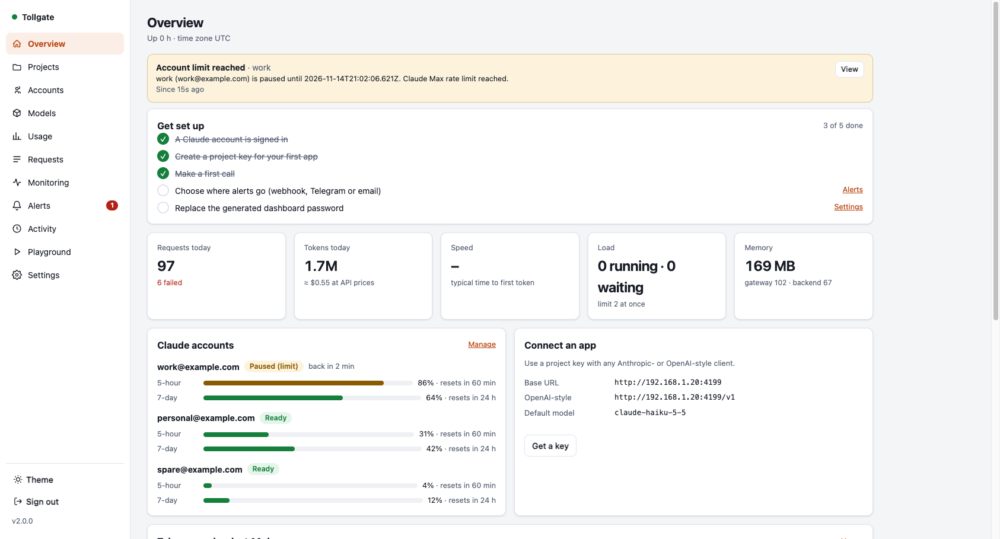
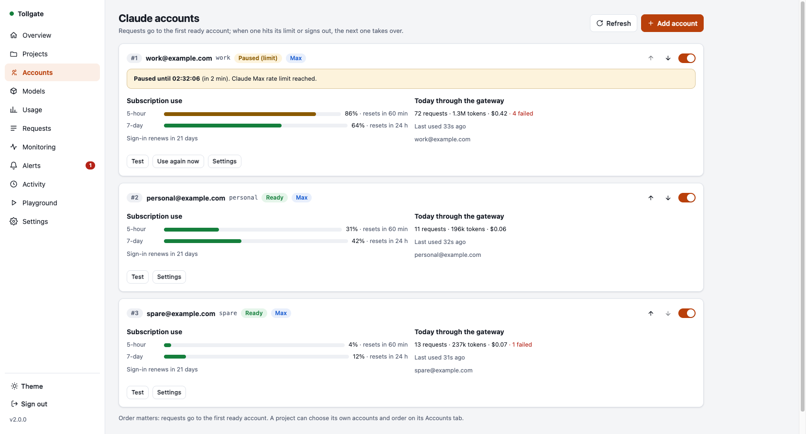
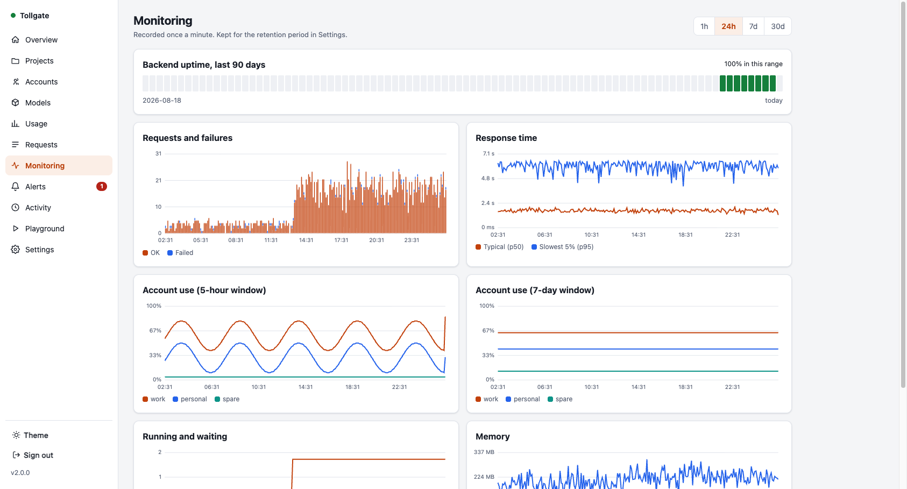
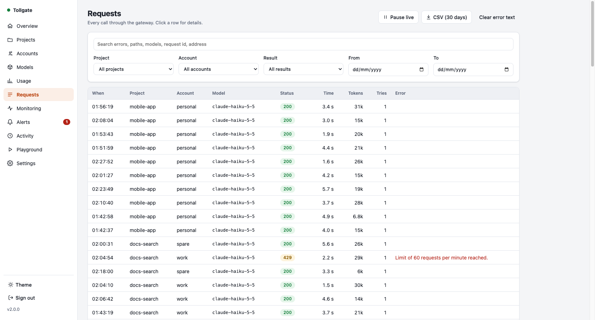
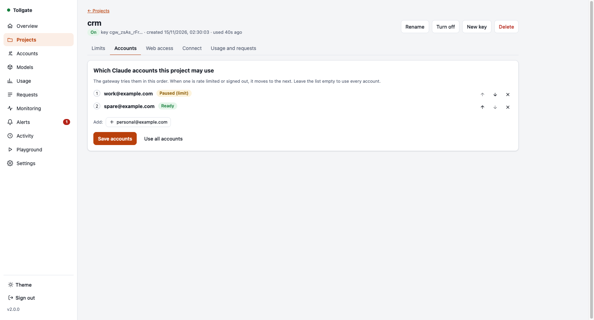
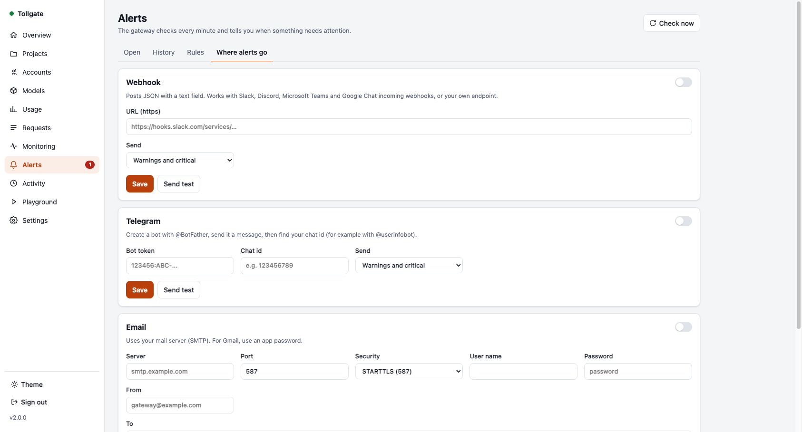
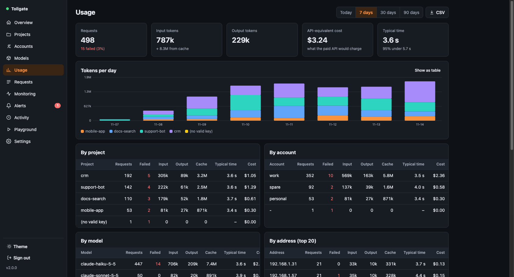
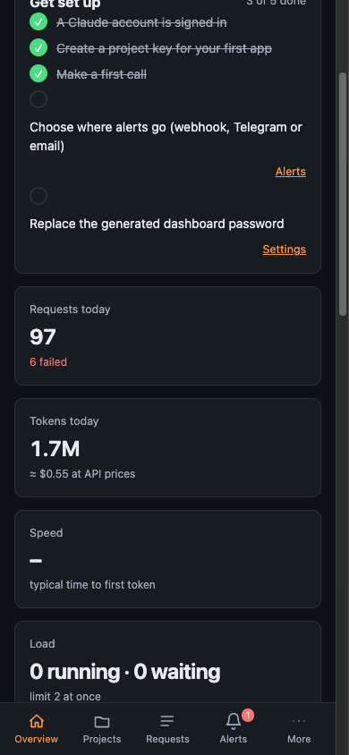
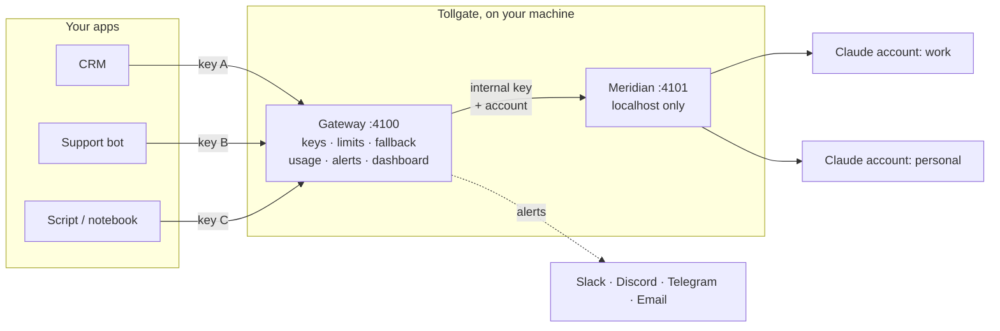
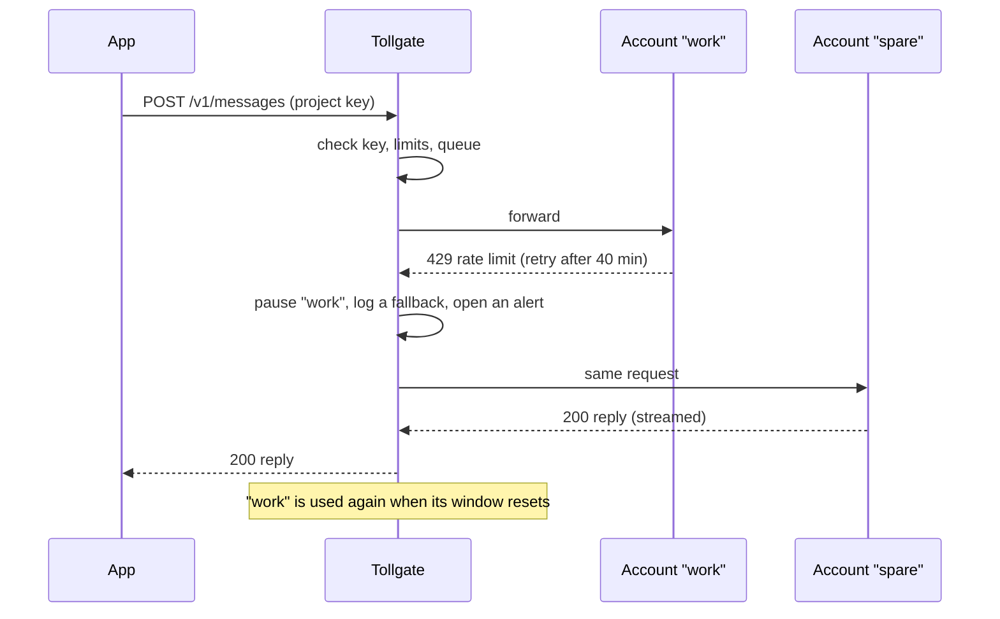

<div align="center">

# 🚦 Tollgate

### Turn your Claude subscription into a private API for all your projects.

Per-project keys · automatic account fallback · limits · usage tracking · monitoring · alerts

[](LICENSE)
[](https://nodejs.org)
[](#-how-it-works)
[](#-quick-start)
[](#-contributing)

[**Quick start**](#-quick-start) · [**Try the demo**](#-try-it-in-30-seconds-no-claude-account-needed) · [**Features**](#-features) · [**Screenshots**](#-screenshots) · [**FAQ**](#-faq) · [**Full guide**](docs/guide.md)



</div>

---

You already pay for Claude and use Claude Code every day. **Tollgate** runs next to it on your machine and gives your own apps (a CRM, a support bot, a side project, a script) a standard **Anthropic- and OpenAI-compatible API**. Each app gets its **own key, limits and usage history**. When one Claude account hits its limit, Tollgate **switches to the next account by itself**, and it **tells you** on Slack, Discord, Telegram or email when something needs attention.

```bash
curl http://localhost:4100/v1/messages \
  -H "x-api-key: cgw_your_project_key" \
  -H "content-type: application/json" \
  -d '{"model":"claude-haiku-5-5","max_tokens":300,"messages":[{"role":"user","content":"Hello!"}]}'
```

> [!IMPORTANT]
> **For your own development and testing.** Tollgate runs on *your* Claude subscription. Don't offer it to other people or as a public service, and only add accounts that are yours. Read Anthropic's [Consumer Terms](https://www.anthropic.com/legal/consumer-terms) first. For production or shared use, get an [Anthropic API key](https://console.anthropic.com/). Tollgate is an independent project and is not affiliated with or endorsed by Anthropic.

## ✨ Features

<table>
<tr>
<td width="50%" valign="top">

### 🔑 A key per project
Every app gets its own `cgw_…` key with:
- requests per minute / day, tokens per day / month
- max output tokens and allowed models
- key expiry and browser (CORS) origins
- "pause this app above X % of the 5-hour quota"

Keys are stored only as hashes and shown once.

</td>
<td width="50%" valign="top">

### 🔁 Accounts with automatic fallback
Add several Claude accounts. When one is **rate limited** or **signed out**, Tollgate pauses it and **retries the same request on the next one**. Your app just gets its reply.
- pick accounts and their order per project
- keep a reserve for your own Claude use
- the account pause ends by itself when the limit resets

</td>
</tr>
<tr>
<td valign="top">

### 📊 Usage you can see
For every request: project, account, model, tokens, cache hits, time to first token, latency, status and the API-equivalent cost. Search it, filter it, export CSV. **Prompts and replies are never stored.**

</td>
<td valign="top">

### 🚨 Monitoring and alerts
A sample every minute, a 90-day uptime strip, and alerts for account limits, sign-outs, backend outages, error spikes, slow replies, full queues and project caps. Sent to **Slack, Discord, Teams, Google Chat** (webhook), **Telegram** or **email**, with quiet hours and reminders.

</td>
</tr>
<tr>
<td valign="top">

### 🧩 Drop-in compatible
- `POST /v1/messages` (Anthropic) with streaming and **tool calling**
- `POST /v1/chat/completions` (OpenAI-style)
- `GET /v1/models`, `POST /v1/messages/count_tokens`

Works with the official SDKs, LangChain, LiteLLM, Cursor-style tools, `curl`, PHP, anything.

</td>
<td valign="top">

### 🪶 Small and self-contained
- the gateway is plain Node 22 with **zero npm dependencies** and built-in SQLite
- about 130–160 MB of memory when idle
- starts at login on **macOS, Linux and Windows**
- restarts itself if anything stops
- optional https, Prometheus `/metrics`

</td>
</tr>
</table>

## 🎬 Try it in 30 seconds (no Claude account needed)

The demo starts Tollgate against a fake backend with two weeks of sample data, three accounts and four projects. It runs in a temporary folder and touches nothing else.

```bash
git clone https://github.com/vishalsharmads/claude-cli-api-gateway.git tollgate
cd tollgate
npm run demo
```

Open **http://127.0.0.1:4199** and sign in with `test-password-123`. Then try the account fallback, the request log, monitoring and alert channels. Press Ctrl+C to stop; the demo data is deleted.

## 🚀 Quick start

**You need:** [Node.js 22.5+](https://nodejs.org), the [Claude Code CLI](https://docs.claude.com/en/docs/claude-code) signed in (`claude` works in a terminal), and git.

<details open>
<summary><b>🍎 macOS / 🐧 Linux</b></summary>

```bash
git clone https://github.com/vishalsharmads/claude-cli-api-gateway.git tollgate
cd tollgate
./install.sh
```

</details>

<details>
<summary><b>🪟 Windows</b></summary>

```bat
git clone https://github.com/vishalsharmads/claude-cli-api-gateway.git tollgate
cd tollgate
install.cmd
```

</details>

The installer installs the backend, registers a login service (launchd, systemd or Task Scheduler), starts everything and prints:

```
  Gateway:    answering (backend healthy)
  Dashboard:  http://localhost:4100   (on your network: http://192.168.1.20:4100)
  Password:   ************            (also in ADMIN_PASSWORD.txt; change it in Settings)
```

Then:

1. Open the dashboard, go to **Projects → New project** and copy the key.
2. Point your app at it:

| Client | Base URL | Key |
|---|---|---|
| Anthropic SDKs (`ANTHROPIC_BASE_URL`) | `http://<host>:4100` | `ANTHROPIC_API_KEY=cgw_…` |
| OpenAI-style clients (`OPENAI_BASE_URL`) | `http://<host>:4100/v1` | `OPENAI_API_KEY=cgw_…` |

<details>
<summary><b>Python</b></summary>

```python
import anthropic
client = anthropic.Anthropic(base_url="http://localhost:4100", api_key="cgw_…")
msg = client.messages.create(model="claude-haiku-5-5", max_tokens=300,
                             messages=[{"role": "user", "content": "Hello"}])
print(msg.content[-1].text)
```

</details>

<details>
<summary><b>Node.js / TypeScript</b></summary>

```js
import Anthropic from "@anthropic-ai/sdk";
const client = new Anthropic({ baseURL: "http://localhost:4100", apiKey: "cgw_…" });
const msg = await client.messages.create({
  model: "claude-haiku-5-5", max_tokens: 300,
  messages: [{ role: "user", content: "Hello" }],
});
console.log(msg.content.at(-1).text);
```

</details>

<details>
<summary><b>PHP (works on shared hosting)</b></summary>

```php
$ch = curl_init('https://tollgate.example.com/v1/messages');
curl_setopt_array($ch, [
  CURLOPT_RETURNTRANSFER => true, CURLOPT_POST => true, CURLOPT_TIMEOUT => 120,
  CURLOPT_HTTPHEADER => ['content-type: application/json', 'x-api-key: ' . getenv('TOLLGATE_KEY'),
                         'anthropic-version: 2023-06-01'],
  CURLOPT_POSTFIELDS => json_encode(['model' => 'claude-haiku-5-5', 'max_tokens' => 300,
                         'messages' => [['role' => 'user', 'content' => 'Hello']]]),
]);
echo end(json_decode(curl_exec($ch), true)['content'])['text'];
```

</details>

<details>
<summary><b>OpenAI-style (any OpenAI-compatible library)</b></summary>

```python
from openai import OpenAI
client = OpenAI(base_url="http://localhost:4100/v1", api_key="cgw_…")
r = client.chat.completions.create(model="claude-haiku-5-5",
                                   messages=[{"role": "user", "content": "Hello"}])
print(r.choices[0].message.content)
```

</details>

<details>
<summary><b>From a web page (browser)</b></summary>

Add your page's origin under **Projects → Web access** (for example `http://localhost:5173`), then call it with `fetch` or the Anthropic JS SDK (`dangerouslyAllowBrowser: true`). The key is visible to anyone who opens the page, so keep that project's limits tight.

</details>

**Add more Claude accounts** (optional) to keep working when one hits its limit:

```bash
node proxy/cli.mjs account add work      # a browser opens; sign in with that account
node proxy/cli.mjs account add main      # add your own account too
```

## 📸 Screenshots

<table>
<tr>
<td width="50%"><br><sub><b>Accounts:</b> quota, reset times, order, reserves and fallback state</sub></td>
<td width="50%"><br><sub><b>Monitoring:</b> uptime, failures, response time and account use over time</sub></td>
</tr>
<tr>
<td><br><sub><b>Requests:</b> live, searchable log. "Tries 2" means it fell back to another account</sub></td>
<td><br><sub><b>Projects:</b> limits, accounts, web access and copy-paste connection snippets</sub></td>
</tr>
<tr>
<td><br><sub><b>Alerts:</b> webhook, Telegram and email, each with a test button</sub></td>
<td><br><sub><b>Usage</b> in dark mode: by project, account, model, day and address</sub></td>
</tr>
</table>

<p align="center"><br><sub>Works on your phone too</sub></p>

## 🔧 How it works



<details>
<summary><b>What happens when an account hits its limit</b></summary>



Streams are checked before anything reaches your app, so even a limit reported in the first event falls back cleanly.

</details>

<details>
<summary><b>The pieces</b></summary>

- **Gateway** (`proxy/`): plain Node 22, no npm dependencies, built-in `node:sqlite`. It checks keys and limits, queues requests, picks the account, forwards the request, streams the reply back unchanged, logs one row per request, samples health every minute and raises alerts. The dashboard is static HTML, JS and CSS with no build step.
- **[Meridian](https://github.com/rynfar/meridian)** (MIT, by rynfar): translates the Anthropic and OpenAI APIs to the Claude Agent SDK and Claude Code CLI, with multi-account profiles. It's installed at a pinned version and listens only on `127.0.0.1`.
- **Supervisor** (`proxy/gateway.mjs`): runs both, restarts them with backoff, rotates logs, and finishes running requests before stopping.
- **Login service**: launchd (macOS), a systemd user unit (Linux) or Task Scheduler (Windows). It runs as you, because the Claude CLI sign-in belongs to your user.

</details>

## 🌍 Use it from anywhere

By default Tollgate answers on your machine and local network. To call it from a VPS, the cloud or shared hosting, put it behind a tunnel. [docs/remote-access.md](docs/remote-access.md) has step-by-step setups for **Cloudflare Tunnel**, **ngrok** and **Tailscale**, including PHP examples for shared hosting.

## ❓ FAQ

<details>
<summary><b>How is this different from calling the Anthropic API?</b></summary>

The API is billed per token and is the right choice for production. Tollgate uses the Claude subscription you already have, which suits your own development, testing and personal tools. Tollgate also adds things the plain CLI doesn't have: keys per project, limits, usage history, fallback and alerts.

</details>

<details>
<summary><b>Do tools / function calling work?</b></summary>

Yes. Your app's tools come back as normal `tool_use` blocks (passthrough mode), and your app runs them, exactly like the API. Tollgate never runs tools on your machine.

</details>

<details>
<summary><b>Is it fast?</b></summary>

A short Haiku reply takes about 1.5–3 seconds, a little slower than the API because each request goes through the Claude Code CLI. Streaming starts as soon as the first token arrives. Two requests run at once by default (adjustable); the rest wait in a queue.

</details>

<details>
<summary><b>Are my prompts stored?</b></summary>

No. Tollgate logs only metadata: project, account, model, token counts, timings, status and error text. The backend runs in its own empty folder, outside any repository, so the model can't see your files.

</details>

<details>
<summary><b>What does "fallback" need?</b></summary>

Two or more Claude accounts added with `node proxy/cli.mjs account add <name>`. Without them, Tollgate uses your normal Claude sign-in and returns a clear `429` with `Retry-After` when you hit your limit. Only add accounts you own.

</details>

<details>
<summary><b>Can my team share one Tollgate?</b></summary>

That isn't what a personal subscription is for. Give each person their own Tollgate, or use the Anthropic API for shared and production use.

</details>

<details>
<summary><b>Which models can I use?</b></summary>

Whatever your subscription offers; `GET /v1/models` lists them. Under **Models** you can turn models off, add short aliases like `haiku` or `sonnet`, and pick the default.

</details>

<details>
<summary><b>Something isn't working</b></summary>

Run `node proxy/cli.mjs status` and `node proxy/cli.mjs logs`, then see [Troubleshooting](docs/guide.md#troubleshooting).

</details>

## 📚 Documentation

| Guide | What's in it |
|---|---|
| [Setup and reference guide](docs/guide.md) | Install, connecting apps, dashboard, limits, https, commands, configuration, troubleshooting, security |
| [Accounts and fallback](docs/accounts.md) | Adding accounts, order, per-project accounts, reserves, what happens on a limit |
| [Monitoring and alerts](docs/alerts.md) | Every rule, Slack / Discord / Telegram / email setup, `/metrics` |
| [Remote access](docs/remote-access.md) | Cloudflare Tunnel, ngrok, Tailscale, shared hosting |
| [Changelog](CHANGELOG.md) | What's new |

## 🤝 Contributing

Issues and pull requests are welcome. See [CONTRIBUTING.md](CONTRIBUTING.md).

```bash
npm test        # starts Tollgate against a fake backend; never touches your accounts
npm run demo    # the dashboard with sample data
```

**Ideas on the list:** a one-command Cloudflare tunnel, per-project allowed source IPs, dashboard users with roles, adding accounts from the dashboard. Open an issue to suggest more.

## 🙏 Credits

- [**Meridian**](https://github.com/rynfar/meridian) by rynfar (MIT) does the hard part: speaking the Claude APIs through the Claude Code CLI.
- [mkcert](https://github.com/FiloSottile/mkcert) for local https.

## 📄 License

[MIT](LICENSE) © 2026 Vishal Sharma. "Claude" is a trademark of Anthropic, PBC. Tollgate is an independent project, not affiliated with or endorsed by Anthropic.

<div align="center">

**If Tollgate saves you time, a ⭐ helps others find it.**

</div>
